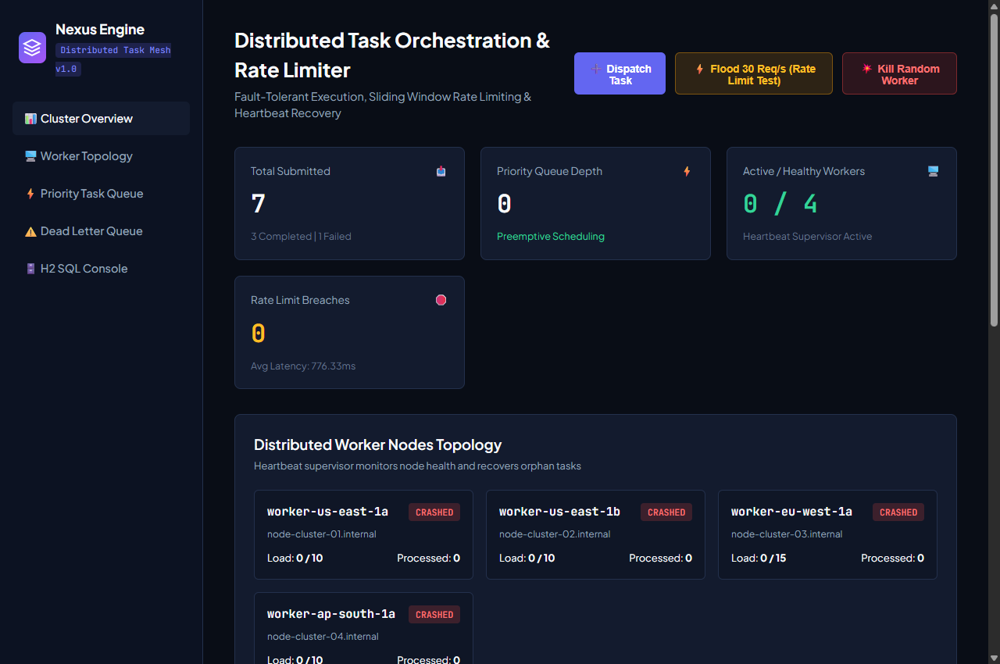
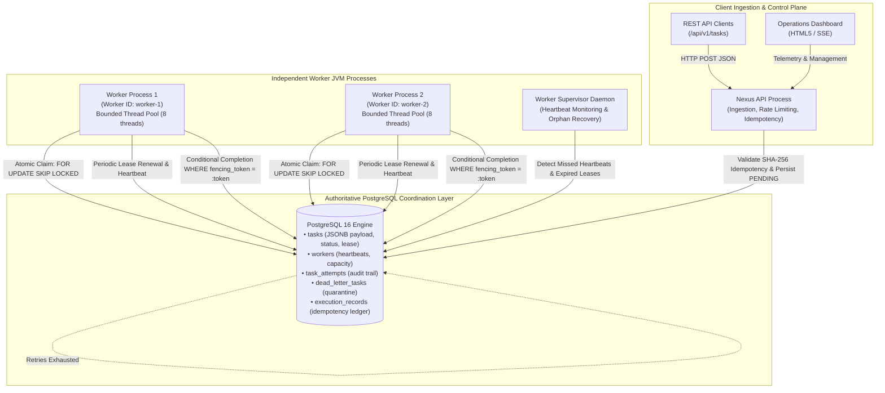
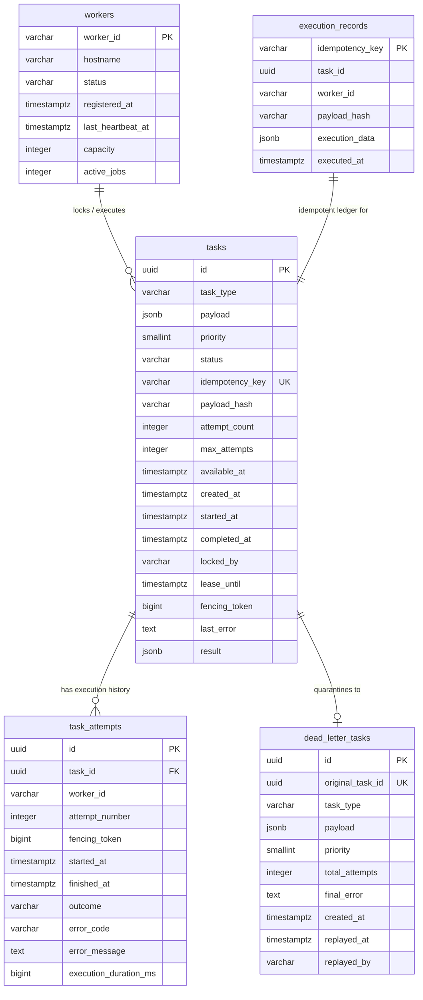

# Nexus 2.0 — Distributed Task Orchestrator & Fault-Tolerant Execution Platform

<div align="center">

[](https://openjdk.org/)
[](https://spring.io/projects/spring-boot)
[](https://www.postgresql.org/)
[](https://www.docker.com/)
[]()
[]()

<br/>

**Production-grade distributed task execution, scheduling, and rate-limiting platform built on Java 21, Spring Boot, and PostgreSQL.**  
Engineered with native PostgreSQL atomic claiming (`SELECT ... FOR UPDATE SKIP LOCKED`), lease-based task ownership, monotonically increasing fencing tokens, supervisor-driven crash detection, at-least-once execution semantics with idempotent handlers, durable dead-letter queue (DLQ) routing, and thread-safe sliding-window rate limiting.

</div>

---

## 📸 Real-Time Cluster Operations Dashboard

Real-time operations console displaying live worker node status (`HEALTHY`, `BUSY`, `DRAINING`, `CRASHED`), active task claims, fencing token progress, sliding-window rate limiter telemetry, and quarantined DLQ records:



---

## 🏛️ System Architecture

Nexus 2.0 is architected as an authoritative database-coordinated distributed system. Work is never coordinated via ephemeral in-memory queues; PostgreSQL serves as the authoritative source of truth.



---

## 📋 Core Architectural Guarantees

| Concern | Implementation Mechanism | Guarantee |
| :--- | :--- | :--- |
| **Persistence Source of Truth** | PostgreSQL 16 with Flyway migrations (`V1__initial_schema.sql`) | All tasks, attempts, and DLQ entries survive node crashes and restarts. |
| **Task Claiming** | `SELECT ... FOR UPDATE SKIP LOCKED` inside CTE transaction | Exactly one worker process claims an eligible task; zero lock contention or duplicate claims. |
| **Execution Semantics** | **At-least-once execution** paired with idempotent task handlers | Tasks will never be silently dropped; crashes trigger lease timeout and reclaim. (Never claimed as exactly-once). |
| **Worker Ownership & Fencing** | Leases + Monotonically increasing `fencing_token` | Stale or slow workers that lost leases cannot overwrite subsequent execution state. |
| **Scheduling Model** | Priority ordering (`CRITICAL=0 > HIGH=1 > NORMAL=2 > LOW=3`) with FIFO tie-breaking (`created_at ASC`) | Priority governs claim selection order among pending tasks. (Non-preemptive across already-running threads). |
| **Retry Backoff** | Full-jitter exponential backoff: `delay = random(0, min(maxDelay, baseDelay * 2^(attempt-1)))` | Stored in PostgreSQL with status `RETRY_WAIT` and `available_at` timestamp. No worker threads blocked. |
| **Rate Limiting** | Sliding Window Counter with concurrent eviction of expired timestamps | Enforced per API instance; prevents admission floods without database lock contention. |
| **Crash Recovery** | Worker heartbeats + lease expiry detection + Docker process resilience | Verified by killing active worker containers mid-execution; task recovered by surviving node. |

---

## 🗄️ Database Design & Schema Migrations

Managed strictly via Flyway migrations located in `src/main/resources/db/migration/V1__initial_schema.sql`.



---

## ⚡ Atomic Distributed Job Claiming

Claiming occurs directly inside PostgreSQL using a single atomic Common Table Expression (CTE) transaction executed by `DistributedTaskDao.java`:

```sql
WITH candidate AS (
    SELECT id
    FROM tasks
    WHERE
        (
            status IN ('PENDING', 'RETRY_WAIT')
            AND available_at <= CURRENT_TIMESTAMP
        )
        OR
        (
            status = 'RUNNING'
            AND lease_until <= CURRENT_TIMESTAMP
            AND attempt_count < max_attempts
        )
    ORDER BY priority ASC, created_at ASC
    LIMIT 1
    FOR UPDATE SKIP LOCKED
)
UPDATE tasks t
SET
    status = 'RUNNING',
    locked_by = :workerId,
    lease_until = CURRENT_TIMESTAMP + (:leaseDurationSeconds * INTERVAL '1 second'),
    fencing_token = t.fencing_token + 1,
    attempt_count = t.attempt_count + 1,
    started_at = COALESCE(t.started_at, CURRENT_TIMESTAMP)
FROM candidate c
WHERE t.id = c.id
RETURNING t.*;
```

### Key Concurrency Properties:
1. **`FOR UPDATE SKIP LOCKED`**: Non-blocking concurrency. Competing workers skip already-locked rows without blocking or deadlocking.
2. **Atomic Token Increment**: `fencing_token = t.fencing_token + 1` increments monotonically in the database clock realm.
3. **Capacity-Aware Polling**: Workers only execute the claim query when their local `ThreadPoolExecutor` has available execution slots. Workers never claim jobs into a local waiting queue to avoid lease expiration while waiting in memory.

---

## 🛡️ Leases, Fencing Tokens, and Stale Worker Protection

To protect against network partitions, GC pauses, and worker crashes:
1. **Lease Renewal**: While executing, workers run a background maintenance loop renewing the lease every `leaseDurationSeconds / 3` (e.g., every 5 seconds for a 15-second lease) verifying `taskId`, `workerId`, and `fencing_token`.
2. **Conditional Completion**: When a task completes, the worker updates the task conditionally:
   ```sql
   UPDATE tasks
   SET status = 'COMPLETED', result = :result, completed_at = CURRENT_TIMESTAMP, locked_by = NULL
   WHERE id = :taskId AND fencing_token = :fencingToken AND status = 'RUNNING';
   ```
   If a worker was paused (e.g., major GC pause or container freeze) and its lease expired and was claimed by another worker, the fencing token will have been incremented. The stale worker's completion query returns `0 rows updated`, causing the stale worker to reject its own result and prevent corrupted writes.

---

## 💥 Truthful Crash Recovery Evidence (Real Docker Verification)

In our real Docker multi-process environment, crash recovery was tested by submitting a 25-second `SLEEP` task, identifying which worker process claimed it, killing that worker abruptly via `docker kill`, and observing the surviving worker re-claim the task upon lease expiry:

### Actual Execution Transcript:
```
=== NEXUS 2.0 DISTRIBUTED CRASH RECOVERY DEMONSTRATION ===
1. Task submitted: 454c883b-f805-42dd-93cd-9b0e2da2cc3e (Status: PENDING)
2. Task claimed by: [worker-2] Status: [RUNNING] FencingToken: [1]
3. Simulating sudden crash: Killing container [nexus-worker-2] with SIGKILL (docker kill)...
nexus-worker-2
Container [nexus-worker-2] abruptly killed! Waiting for lease expiration (lease=15s) and recovery by [nexus-worker-1]...
[19:37:17] Status: RUNNING | FencingToken: 1 | Attempts: 1
[19:37:19] Status: RUNNING | FencingToken: 1 | Attempts: 1
[19:37:21] Status: RUNNING | FencingToken: 1 | Attempts: 1
[19:37:23] Status: RUNNING | FencingToken: 1 | Attempts: 1
[19:37:25] Status: RUNNING | FencingToken: 1 | Attempts: 1
[19:37:27] Status: RUNNING | FencingToken: 1 | Attempts: 1
[19:37:29] Status: RUNNING | FencingToken: 2 | Attempts: 2
[19:37:31] Status: RUNNING | FencingToken: 2 | Attempts: 2
[19:37:55] Status: COMPLETED | FencingToken: 2 | Attempts: 2

SUCCESS! Task recovered and completed by surviving worker!
Final Fencing Token: 2
Total Execution Attempts: 2
  -> Attempt 1: Worker=[worker-2] Outcome=[] FencingToken=[1]
  -> Attempt 2: Worker=[worker-1] Outcome=[COMPLETED] FencingToken=[2]

5. Restarting crashed container [nexus-worker-2]...
Checking cluster workers status...
  Worker [worker-2]: Status=CRASHED Host=faeede5b4117 LastHeartbeat=2026-11-03T14:07:13.448158Z
  Worker [worker-1]: Status=HEALTHY Host=da2965a237c8 LastHeartbeat=2026-11-03T14:08:00.030832Z
=== CRASH RECOVERY VERIFICATION COMPLETE ===
```

---

## ⚙️ Pluggable Task Handlers

Registered in `TaskHandlerRegistry.java`:
1. **`NO_OP`**: Validates scheduling and low-latency claim overhead.
2. **`SLEEP`**: Configurable duration (`durationMs`) with cooperative cancellation checks (`Thread.currentThread().isInterrupted()`) and ownership verification (`context.isOwnershipValid()`).
3. **`FAIL_N_TIMES`**: Injects simulated transient hardware/network exceptions for the first `N` attempts before succeeding, validating the persistent retry engine.
4. **`RECORD_EXECUTION`**: Demonstrates business idempotency by writing to the `execution_records` ledger table protected by a PostgreSQL `UNIQUE(idempotency_key)` constraint.

---

## 🔁 Persistent Retry & Dead Letter Queue (DLQ)

- **Backoff Algorithm**: Full-jitter exponential backoff:
  $$\text{delay} = \text{random}(0, \min(\text{maxDelay}, \text{baseDelay} \times 2^{\text{attempt}-1}))$$
- **Non-blocking State**: Tasks move to `status = 'RETRY_WAIT'` and `available_at = CURRENT_TIMESTAMP + delay`. Worker threads are immediately released.
- **Exhaustion Routing**: If `attempt_count >= max_attempts`, the task is transitioned to `DEAD_LETTERED`, and a detailed record is quarantined in `dead_letter_tasks` with original payload, total attempts, and sanitised error context.
- **DLQ Replay**: Replaying a dead-lettered task via `POST /api/v1/dlq/{id}/replay` resets `attempt_count = 0`, sets `status = 'PENDING'`, and records audit metadata (`replayed_at`, `replayed_by`).

---

## 🚦 Sliding-Window Rate Limiting

- **Scope**: Thread-safe sliding window counter per API process instance.
- **Algorithm**: Eviction of timestamps outside the current window followed by atomic size verification and timestamp insertion.
- **Time Complexity**: $O(k)$ where $k$ is the number of expired timestamps evicted; amortized $O(1)$ per operation.
- **Rejection**: Exceeded quota returns `HTTP 429 Too Many Requests` with a calculated `Retry-After` header.

---

## 🧪 Comprehensive Automated Test Suite

Tested with JUnit 5, Mockito, Spring Boot Test, and Testcontainers PostgreSQL:

### Unit Tests (`com.nexus.orchestrator.unit`):
- `PriorityAndFifoOrderingTest`: Verifies priority order `CRITICAL(0) > HIGH(1) > NORMAL(2) > LOW(3)` and FIFO tie-breaking on equal priority.
- `FencingTokenAndLeaseRulesUnitTest`: Verifies monotonically increasing tokens and conditional update rules.
- `IdempotencyValidationUnitTest`: Verifies SHA-256 payload hash checking and `409 Conflict` generation on duplicate key with mismatched payload.
- `RetryPolicyAndExceptionClassificationTest`: Verifies exponential backoff with full jitter and retryable vs fatal exception classification.
- `SlidingWindowRateLimiterUnitTest`: Verifies rate limiting, window sliding, quota exhaustion, and thread safety.
- `TaskHandlersUnitTest`: Verifies execution logic across `NO_OP`, `SLEEP`, `FAIL_N_TIMES`, and `RECORD_EXECUTION`.

### Testcontainers PostgreSQL Concurrency & Recovery Integration Tests:
- `PostgresConcurrencyAndRecoveryIntegrationTest`:
  - 10 concurrent threads racing `claimReadyTask()` against real PostgreSQL — exactly one worker claims each task.
  - Priority ordering verification in PostgreSQL (`priority ASC, created_at ASC`).
  - Worker lease expiration recovery: task re-claimed with incremented fencing token.
  - Expired tasks with exhausted retries swept to `dead_letter_tasks`.
  - Stale worker completion rejected when fencing token changes.
  - Idempotent execution table unique constraint handling under concurrent races.
- `ApiEndpointIntegrationTest`:
  - `POST /api/v1/tasks`: Valid submission returns `202 Accepted`.
  - Idempotency validation: Identical payload returns existing task; altered payload returns `409 Conflict`.
  - Status and Priority filtering on `GET /api/v1/tasks`.
  - Secure DLQ replay requiring admin authentication.

### Running Tests Locally:
```bash
# Run all unit tests
mvn test -Dtest=*UnitTest,*OrderingTest,*ClassificationTest

# Run Testcontainers PostgreSQL integration tests
mvn test -Dtest=PostgresConcurrencyAndRecoveryIntegrationTest,ApiEndpointIntegrationTest
```

---

## 🚀 Quickstart & Docker Compose Deployment

### Prerequisites:
- Java 21 JDK
- Maven 3.9+
- Docker & Docker Compose

### 1. Build Application:
```bash
mvn clean package -DskipTests
```

### 2. Start Distributed Cluster:
```bash
docker compose up -d --build
```

### 3. Verify Containers:
```bash
docker compose ps
```
Output:
```
NAME             IMAGE                                          STATUS                    PORTS
nexus-api        distributed-task-orchestrator-main-nexus-api   Up (healthy)              0.0.0.0:8080->8080/tcp
nexus-postgres   postgres:16-alpine                             Up (healthy)              0.0.0.0:5432->5432/tcp
nexus-worker-1   distributed-task-orchestrator-main-worker-1    Up (healthy)              8080/tcp
nexus-worker-2   distributed-task-orchestrator-main-worker-2    Up (healthy)              8080/tcp
```

### 4. Submit Multi-Priority Tasks:
```bash
# Critical priority task
curl -X POST http://localhost:8080/api/v1/tasks \
  -H "Content-Type: application/json" \
  -d '{
    "taskName": "Critical-Payment-Reconciliation",
    "taskType": "RECORD_EXECUTION",
    "priority": "CRITICAL",
    "payload": "{\"amount\": 999.50}",
    "idempotencyKey": "PAY-REC-001",
    "submittedBy": "finance-service"
  }'

# Sleep task to observe distributed execution
curl -X POST http://localhost:8080/api/v1/tasks \
  -H "Content-Type: application/json" \
  -d '{
    "taskName": "Long-Running-Analytics",
    "taskType": "SLEEP",
    "priority": "HIGH",
    "payload": "{\"durationMs\": 10000}",
    "submittedBy": "analytics-cron"
  }'
```

### 5. View Cluster Telemetry & Active Workers:
```bash
# Check registered workers in PostgreSQL
curl -s http://localhost:8080/api/v1/workers | jq .

# Check cluster metrics
curl -s http://localhost:8080/api/v1/metrics/summary | jq .
```

### 6. Access Operations Dashboard:
Open your browser to:
```
http://localhost:8080
```

---

## 🔒 Security & Admin Authentication

Endpoints that alter cluster operational state (`POST /api/v1/dlq/{id}/replay`, `POST /api/v1/dlq/replay-all`) require admin authentication via the `X-API-KEY` header matching `NEXUS_API_KEY` (configured in `docker-compose.yml` or `application.yml`).

---

## 📜 Accurate Terminology & System Semantics

To maintain truthful systems engineering descriptions:
- **At-least-once execution**: Tasks may be executed more than once if a worker process crashes mid-execution. Handlers must be idempotent. Nexus makes **no claim** of exactly-once execution.
- **Priority-based dispatch**: Tasks are claimed in priority order (`CRITICAL > HIGH > NORMAL > LOW`) when pending. Already-running tasks are **not preempted** unless cooperative interruption is explicitly invoked.
- **True Multi-Process Isolation**: Demonstrated using separate JVM processes in Docker containers (`nexus-api`, `nexus-worker-1`, `nexus-worker-2`) sharing PostgreSQL 16.
