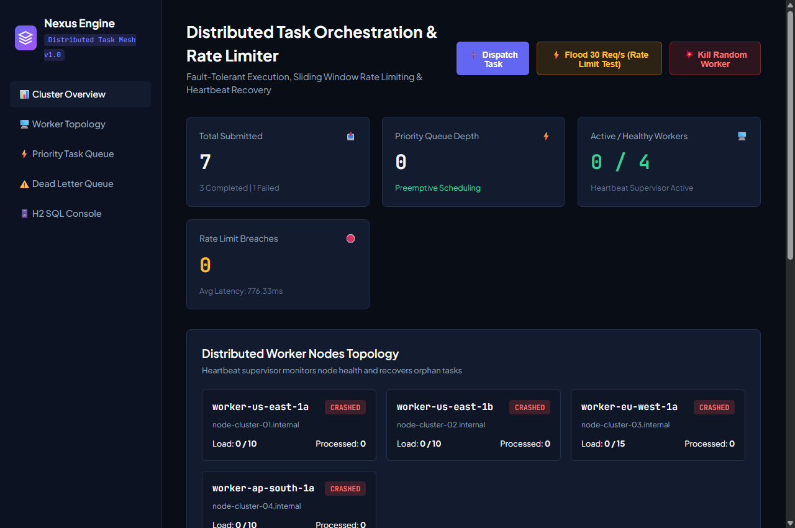
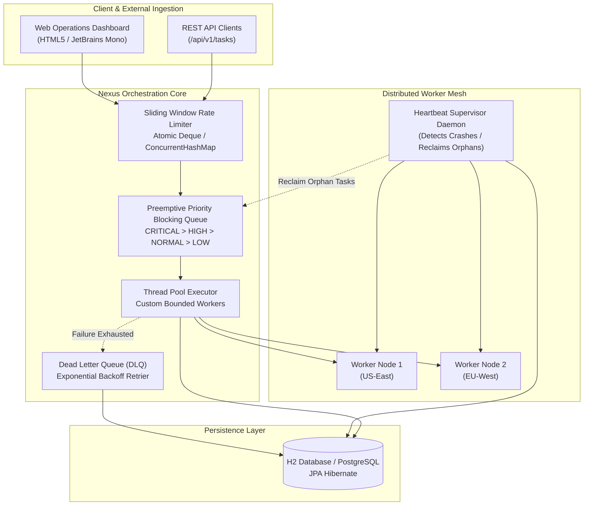
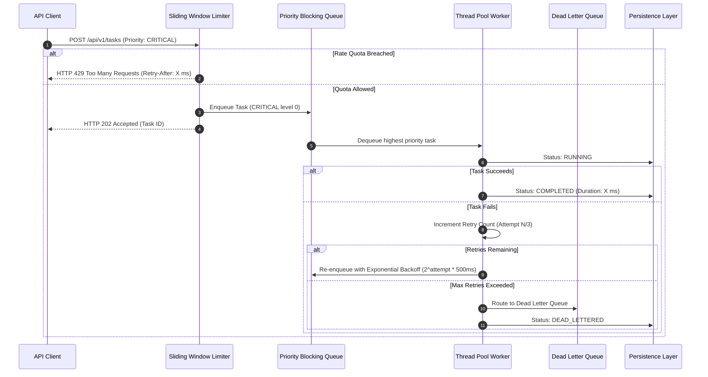

# Nexus: High-Throughput Distributed Task Orchestrator & Rate Limiter

<div align="center">

[](https://openjdk.org/)
[](https://spring.io/projects/spring-boot)
[](https://www.docker.com/)
[]()
[]()

<br/>

**High-throughput distributed task scheduling and rate limiting platform built on Java 21, Spring Boot, and `java.util.concurrent`.**  
Engineered with preemptive priority queuing, sliding-window rate limiting, heartbeat supervisor crash recovery, and automated dead-letter queue (DLQ) retry routing.

</div>

---

## 📸 Application Dashboard

Real-time cluster overview displaying live worker node topology, preemptive task execution states, sliding window rate-limiting telemetry, and quarantined dead-letter records:



---

## 🏛️ System Architecture

Nexus is organized into four core layers: an API Control Plane, a Concurrency Scheduling Engine, a Cluster Supervisor with Fault Tolerance, and an In-Memory / Persistent Metadata Store.



---

## 🔄 Preemptive Scheduling & Failure Recovery Flow

When tasks are submitted, they are ordered by priority level before worker thread assignment. Failed tasks transition through exponential retry cycles before quarantine:



---

## 🔄 Worker Heartbeat & Crash Recovery State Machine

Workers send periodic heartbeats to maintain active status. If a worker fails, the supervisor reclaims running tasks to guarantee at-least-once execution:

```mermaid
stateDiagram-v2
    [*] --> HEALTHY: Worker Registered
    HEALTHY --> BUSY: Task Capacity Saturated
    BUSY --> HEALTHY: Tasks Completed
    HEALTHY --> CRASHED: Heartbeat Timeout Exceeded (>15s)
    BUSY --> CRASHED: Heartbeat Timeout Exceeded (>15s)
    
    state CRASHED {
        Reclaim_Orphans: Supervisor detects missed heartbeat
        Re-enqueue: Orphan tasks re-routed to healthy workers
        Reclaim_Orphans --> Re-enqueue
    }

    CRASHED --> HEALTHY: Worker Restored & Sends Heartbeat
    CRASHED --> OFFLINE: Operator Decommissions Node
    OFFLINE --> [*]
```

---

## 🔬 Core Algorithms & Mathematical Foundations

### 1. Sliding Window Rate Limiter
Standard fixed-window counters allow $2\times$ traffic spikes at window boundaries. Nexus implements an atomic **Sliding Window Log** counter per client:
$$\text{Window} = [t_{\text{now}} - \Delta t, t_{\text{now}}]$$
* Evicts expired timestamps in $O(\log n)$ using an atomic double-ended queue (`ArrayDeque<Long>`).
* Uses per-client fine-grained `ReentrantLock` instances inside a `ConcurrentHashMap` to eliminate global lock contention across tenants.
* If $\text{Size}(\text{Window}) + \text{Tokens} > \text{Limit}$, returns:
  $$\text{Retry-After} = (t_{\text{oldest}} + \Delta t) - t_{\text{now}}$$

### 2. Preemptive Priority Queue Scheduling
Tasks implement `Comparable<Task>` based on a two-tier comparator:
```java
int priorityCompare = Integer.compare(this.priority.getLevel(), other.priority.getLevel());
if (priorityCompare != 0) return priorityCompare;
return this.createdAt.compareTo(other.createdAt); // FIFO tie-breaker
```
Tasks marked **`CRITICAL (0)`** immediately jump ahead of `HIGH (1)`, `NORMAL (2)`, and `LOW (3)` tasks awaiting execution in the bounded queue.

### 3. Exponential Backoff with DLQ Quarantine
When tasks experience transient external failures, retry intervals scale exponentially to protect downstream dependencies:
$$\text{Delay}(n) = 2^n \times 500\text{ ms}$$
Tasks exceeding $N_{\max} = 3$ retries are quarantined in the **Dead Letter Queue (DLQ)** along with the full failure stacktrace for manual inspection or replay.

---

## ⚡ Quickstart Guide

### Prerequisites
* **Java 21 LTS**
* **Maven 3.9+** (or use Docker)

### Run Locally

```bash
# Clone the repository
git clone https://github.com/yourusername/nexus-task-orchestrator.git
cd nexus-task-orchestrator

# Run automated test suite (7 tests)
mvn test

# Package and run the executable JAR
mvn package -DskipTests
java -jar target/distributed-task-orchestrator-1.0.0.jar
```
Navigate to **`http://localhost:8080`** in your browser to access the control plane dashboard.

---

### Run with Docker Compose

```bash
docker compose up -d --build
```

---

## 🌐 REST API Endpoints

| Method | Endpoint | Description |
| :--- | :--- | :--- |
| `GET` | `/` | Web Operations Dashboard |
| `POST` | `/api/v1/tasks` | Submits task with priority and rate limiting |
| `GET` | `/api/v1/tasks` | Lists recent tasks with status & execution latencies |
| `GET` | `/api/v1/tasks/{id}` | Fetches task details and retry history |
| `POST` | `/api/v1/tasks/{id}/cancel` | Cancels queued task before execution |
| `POST` | `/api/v1/tasks/{id}/retry` | Manually re-queues a failed/dead-lettered task |
| `GET` | `/api/v1/workers` | Lists worker cluster nodes and load metrics |
| `POST` | `/api/v1/workers/{id}/heartbeat`| Records worker heartbeat |
| `POST` | `/api/v1/workers/{id}/crash` | Injects simulated worker crash (Chaos testing) |
| `POST` | `/api/v1/workers/{id}/recover` | Recovers crashed worker to HEALTHY state |
| `GET` | `/api/v1/dlq` | Lists quarantined dead-letter tasks |
| `POST` | `/api/v1/dlq/{id}/replay` | Replays dead-lettered task into the scheduler |
| `GET` | `/api/v1/metrics/summary` | Cluster throughput, latency & queue metrics |

---

## 🧪 Automated Test Suite

Verified via JUnit 5, Mockito, and Spring Boot MockMvc:

* `SlidingWindowRateLimiterTest`: Validates window bounds, quota exhaustion, and thread safety under 20 concurrent threads.
* `TaskExecutionEngineTest`: Validates priority dispatch, asynchronous execution, and DLQ routing.
* `WorkerHeartbeatSupervisorTest`: Validates missed heartbeat detection and orphan task reclamation.
* `TaskControllerIntegrationTest`: End-to-end HTTP integration test for submission, retrieval, and 429 response validation.

---

## 📄 License

Distributed under the **MIT License**. See `LICENSE` for details.
